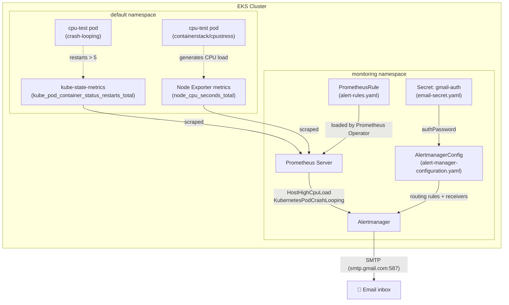
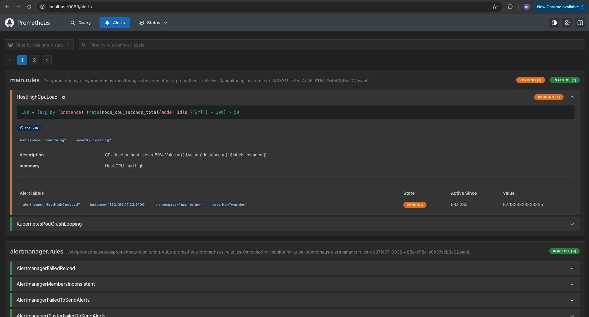
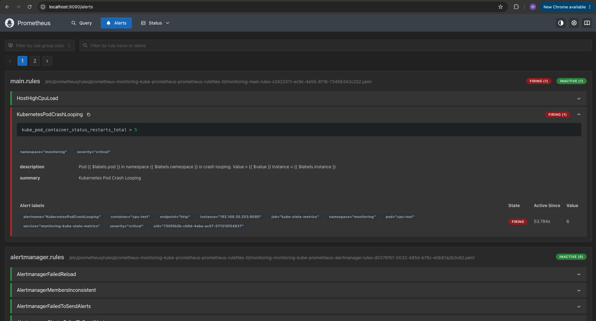
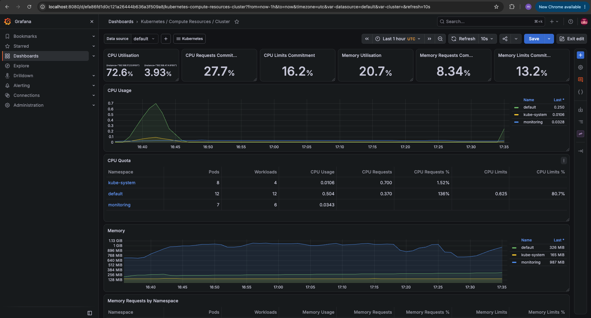
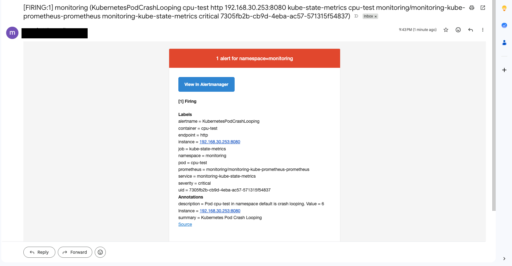

# 🚨 Prometheus Configure Alerting for our Application


**Prometheus** is an open-source monitoring and alerting toolkit that collects metrics from configured targets at regular intervals, stores them as time series data, and lets you query, visualize, and alert on them using its own query language, **PromQL**. *(Source: [prometheus.io docs](https://prometheus.io/docs/introduction/overview/))*

## 🔭 Overview

This project builds on top of an existing `kube-prometheus-stack` deployment (see the [Install Prometheus Stack in Kubernetes](https://github.com/mustafa-saleh/install-prometheus-stack-in-kubernetes) demo) and focuses purely on **alerting**: defining custom `PrometheusRule` resources, validating that Prometheus correctly evaluates and fires them under real failure/load conditions, and wiring up **Alertmanager** with an email receiver so that the on-call engineer is proactively notified the moment something goes wrong in the cluster — without needing to stare at dashboards.

### 📈 Prometheus Monitoring

Prometheus continuously evaluates PromQL expressions defined inside **alerting rules**, and whenever an expression's result crosses the configured threshold for long enough (the `for` duration), the rule transitions through three states:

- 🟢 **Inactive** – the condition is currently false.
- 🟠 **Pending** – the condition became true, but hasn't been true long enough yet.
- 🔴 **Firing** – the condition has been true for at least the `for` duration, and the alert is sent to **Alertmanager**.

Alertmanager then takes over: it deduplicates, groups, and routes firing alerts to the correct **receiver** (email, Slack, PagerDuty, Opsgenie, etc.) based on label matchers, and can silence or inhibit alerts to avoid notification fatigue. In a Prometheus Operator-managed cluster, both the alerting rules and the Alertmanager routing configuration are expressed as Kubernetes custom resources (`PrometheusRule` and `AlertmanagerConfig`), so the entire alerting pipeline is version-controlled, reviewable, and deployed the same way as any other Kubernetes manifest.

## 🎯 Demo Project

Prometheus Configure Alerting for our Application

## 🛠️ Technologies used

- Prometheus
- Kubernetes
- Linux

## 📝 Project Description

- Configure our Monitoring Stack to notify us whenever CPU usage > 50% or Pod cannot start
- Configure Alert Rules in Prometheus Server
- Configure Alertmanager with Email Receiver

## 📁 Repository structure

```
prometheus-configure-alerting-for-our-application/
├── README.md                          # This documentation file
├── NOTES.md                           # Raw working notes taken during the implementation
├── config-microservices.yaml          # Kubernetes manifests for the "Online Boutique" demo microservices app
├── alert-rules.yaml                   # PrometheusRule CRD - HostHighCpuLoad & KubernetesPodCrashLooping alerts
├── alert-manager-configuration.yaml   # AlertmanagerConfig CRD - routes alerts to the email receiver
├── email-secret.yaml                  # Kubernetes Secret holding the SMTP app-password (placeholder value)
├── .gitignore
└── images/                            # Screenshots captured from cloud console, terminal & browser
    ├── prometheus-alert-fired.png
    ├── prometheus-ui-alert-browser.png
    ├── grafana-dashboard-cpu-spike-browser.png
    └── alert-email-received.png
```

## 🏗️ Architecture overview



The **Prometheus Operator** watches for `PrometheusRule` and `AlertmanagerConfig` custom resources cluster-wide (filtered by matching `labels`/`release` selectors) and automatically regenerates the underlying `prometheus.yml` / Alertmanager configuration, triggering a hot reload via the **config-reloader** sidecar container — no manual restarts required.

## 🚀 Implementation Guide

### 1. Prerequisites

This project assumes the monitoring stack from [Install Prometheus Stack in Kubernetes](https://github.com/mustafa-saleh/install-prometheus-stack-in-kubernetes) is already up and running. Make sure you have:

- A running **AWS EKS cluster** created with `eksctl create cluster`.
- The **kube-prometheus-stack** Helm chart already installed in the `monitoring` namespace (provides the Prometheus Operator, Prometheus server, Alertmanager and Grafana).
- [**kubectl**](https://kubernetes.io/docs/tasks/tools/) configured to talk to the cluster.
- A **Gmail account** with [2-Step Verification](https://myaccount.google.com/security) enabled, used to generate an **App Password** for the Alertmanager SMTP email receiver.

Verify connectivity to the cluster and that the monitoring namespace is healthy:

```bash
kubectl get nodes
kubectl get all -n monitoring
```

> ⚠️ **Security note**: `email-secret.yaml` stores the SMTP credential as a base64-encoded Kubernetes `Secret`. Base64 is **encoding, not encryption** — never commit a real password/app-password to a public repository. In this repo the value is a placeholder; for your own deployment, generate the secret locally (`kubectl create secret generic gmail-auth --from-literal=password=<app-password> -n monitoring --dry-run=client -o yaml`) or use a secrets manager (AWS Secrets Manager, Sealed Secrets, External Secrets Operator) instead of committing the YAML.

### 2. Define custom Alert Rules in Prometheus

Alerting rules are declared using the Prometheus Operator's `PrometheusRule` CRD. The `release: monitoring` and `app: kube-prometheus-stack` labels are required so the Operator's rule selector picks up the resource and loads it into the running Prometheus server. [config-microservices.yaml](config-microservices.yaml) already provides the Online Boutique workload used as the monitored target.

[alert-rules.yaml](alert-rules.yaml) defines two rules:

```yaml
apiVersion: monitoring.coreos.com/v1
kind: PrometheusRule
metadata:
  name: main.rules
  namespace: monitoring
  labels:
    app: kube-prometheus-stack
    release: monitoring
spec:
  groups:
  - name: main.rules
    rules:
    - alert: HostHighCpuLoad
      expr: 100 - (avg by(instance) (rate(node_cpu_seconds_total{mode="idle"}[2m])) * 100) > 50
      for: 2m
      labels:
        severity: warning
        namespace: monitoring
      annotations:
        description: "CPU load on host is over 50%\n Value = {{ $value }}\n Instance = {{ $labels.instance }}\n"
        summary: "Host CPU load high"
    - alert: KubernetesPodCrashLooping
      expr: kube_pod_container_status_restarts_total > 5
      for: 0m
      labels:
        severity: critical
        namespace: monitoring
      annotations:
        description: "Pod {{ $labels.pod }} in namespace {{ $labels.namespace }} is crash looping.\n Value = {{ $value }}\n Instance = {{ $labels.instance }}\n"
        summary: "Kubernetes Pod Crash Looping"
```

- **`HostHighCpuLoad`** – fires when average node CPU utilization stays above **50%** for **2 minutes**, computed from the `node_cpu_seconds_total` metric exposed by Node Exporter.
- **`KubernetesPodCrashLooping`** – fires **immediately** (`for: 0m`) when a pod has restarted more than 5 times, using the `kube_pod_container_status_restarts_total` metric exposed by `kube-state-metrics`.

Apply the rule to the cluster and confirm it was registered:

```bash
kubectl apply -f alert-rules.yaml
kubectl get prometheusrules -n monitoring
```

Prometheus ships with a **config-reloader** sidecar container that watches for changes and hot-reloads the configuration without restarting the main process. Confirm the reload succeeded via the container logs:

```bash
kubectl get pods -n monitoring
# -c config-reloader to specify which container logs you're interested in, as the prometheus pod has multiple containers
kubectl logs prometheus-monitoring-kube-prometheus-prometheus-0 -n monitoring -c config-reloader
# to check prometheus logs
kubectl logs prometheus-monitoring-kube-prometheus-prometheus-0 -n monitoring -c prometheus
```

Port-forward the Prometheus UI and open the **Alerts** tab to confirm both rules were loaded under the `main.rules` group:

```bash
kubectl port-forward svc/monitoring-kube-prometheus-prometheus 9090:9090 -n monitoring &
```



### 3. Trigger the alerts under real conditions

To prove the alerting pipeline actually works (rather than just being "configured"), both failure conditions were deliberately simulated.

**Trigger `HostHighCpuLoad`** by running a CPU stress-testing container that consumes 4 CPU cores for 30 seconds:

```bash
kubectl run cpu-test --image=containerstack/cpustress -- --cpu 4 --timeout 30s --metrics-brief
```

**Trigger `KubernetesPodCrashLooping`** by restarting the `cpu-test` pod with a short timeout, causing it to repeatedly exit and restart past the 5-restart threshold:

```bash
kubectl delete pod cpu-test
kubectl run cpu-test --image=containerstack/cpustress -- --cpu 4 --timeout 60s --metrics-brief
```

After a couple of minutes, refreshing the Prometheus **Alerts** tab shows `KubernetesPodCrashLooping` transitioning to **FIRING**:



The underlying CPU spike responsible for `HostHighCpuLoad` is also visible on the **Kubernetes / Compute Resources / Cluster** Grafana dashboard:



The firing alerts can also be queried directly from the Alertmanager API:

```bash
curl -X GET http://localhost:9093/api/v2/alerts
```

### 4. Configure Alertmanager with an Email Receiver

By default, the Alertmanager instance deployed by the Helm chart has **no receivers configured** — alerts fire in Prometheus but nobody is notified. The Prometheus Operator's `AlertmanagerConfig` CRD is used to declare routing rules and a receiver, without touching the Alertmanager's raw YAML configuration directly.

[alert-manager-configuration.yaml](alert-manager-configuration.yaml) routes each alert to an `email` receiver, with a tighter `repeatInterval` for the critical crash-loop alert:

```yaml
apiVersion: monitoring.coreos.com/v1alpha1
kind: AlertmanagerConfig
metadata:
  name: main-rules-alert-config
  namespace: monitoring
spec:
  route:
    receiver: 'email'
    repeatInterval: 30m
    routes:
    - matchers:
      - name: alertname
        value: HostHighCpuLoad
    - matchers:
      - name: alertname
        value: KubernetesPodCrashLooping
      repeatInterval: 10m
  receivers:
  - name: 'email'
    emailConfigs:
    - to: '<your-email>@gmail.com'
      from: '<your-email>@gmail.com'
      smarthost: 'smtp.gmail.com:587'
      authUsername: '<your-email>@gmail.com'
      authIdentity: '<your-email>@gmail.com'
      authPassword:
        name: gmail-auth
        key: password
```

The SMTP password is never stored in plain text inline — it's referenced from a Kubernetes `Secret` (`gmail-auth`), defined in [email-secret.yaml](email-secret.yaml):

```yaml
apiVersion: v1
kind: Secret
type: Opaque
metadata:
  name: gmail-auth
  namespace: monitoring
data:
  password: base64-encoded-value-of-your-password
```

To authenticate with Gmail's SMTP server, a Google Account **App Password** is required (regular account passwords are rejected by Gmail for SMTP clients once 2-Step Verification is enabled). Generate one from your Google Account under **Security → 2-Step Verification → App passwords**, or directly at [myaccount.google.com/apppasswords](https://myaccount.google.com/apppasswords), selecting "Mail" as the app.

Apply the secret and the Alertmanager configuration to the cluster:

```bash
kubectl apply -f email-secret.yaml
kubectl apply -f alert-manager-configuration.yaml
kubectl get alertmanagerconfig -n monitoring
# check config reload
kubectl get pods -n monitoring
kubectl logs alertmanager-monitoring-kube-prometheus-alertmanager-0 -n monitoring -c config-reloader
```

Port-forward the Alertmanager UI to confirm the configuration, routes, and receiver were loaded correctly:

```bash
# localhost:9093
kubectl port-forward svc/monitoring-kube-prometheus-alertmanager 9093:9093 -n monitoring &
```

> 📖 Full `AlertmanagerConfig` CRD reference: [Red Hat OpenShift Monitoring APIs docs](https://docs.redhat.com/en/documentation/openshift_container_platform/4.16/html/monitoring_apis/alertmanagerconfig-monitoring-coreos-com-v1beta1)

### 5. Verify the alert notification is delivered

With the `KubernetesPodCrashLooping` alert already firing from step 3, and the email receiver now configured, Alertmanager delivers the notification to the configured inbox within the `repeatInterval` window:



The email contains the full set of **labels** (alert name, severity, namespace, pod, instance) and **annotations** (human-readable summary/description) defined in the `PrometheusRule`, giving the on-call engineer immediate, actionable context without needing to open a dashboard. If no email arrives, check the Alertmanager logs for SMTP authentication or delivery errors:

```bash
kubectl logs alertmanager-monitoring-kube-prometheus-alertmanager-0 -n monitoring -c alertmanager
```

## 🏁 Final result

By the end of this demo, the monitoring stack actively notifies the team of real incidents instead of requiring someone to watch a dashboard:

- ✅ Two custom `PrometheusRule` alerts deployed declaratively: `HostHighCpuLoad` (CPU > 50% for 2m) and `KubernetesPodCrashLooping` (> 5 restarts).
- ✅ Both alert conditions deliberately reproduced using a CPU-stress container, proving the rules evaluate correctly end-to-end.
- ✅ Alertmanager configured via the `AlertmanagerConfig` CRD with per-alert routing and a secure, Secret-backed Gmail SMTP email receiver.
- ✅ Alert notifications confirmed delivered to the inbox with full label/annotation context.
- ✅ Config-reloader sidecars validated to confirm hot-reloads of both Prometheus rules and Alertmanager configuration, with zero downtime or manual restarts.

This closes the loop on the monitoring stack: metrics are collected, visualized, alerted on, and now actively **pushed** to the people who need to act on them.

## 📚 References

- [Prometheus Alerting Rules Documentation](https://prometheus.io/docs/prometheus/latest/configuration/alerting_rules/)
- [Prometheus Operator – AlertmanagerConfig API Reference](https://docs.redhat.com/en/documentation/openshift_container_platform/4.16/html/monitoring_apis/alertmanagerconfig-monitoring-coreos-com-v1beta1)
- [Alertmanager Documentation](https://prometheus.io/docs/alerting/latest/alertmanager/)
- [kube-state-metrics Documentation](https://github.com/kubernetes/kube-state-metrics)
- [eksctl Documentation](https://eksctl.io/)
- [Amazon EKS User Guide](https://docs.aws.amazon.com/eks/latest/userguide/what-is-eks.html)
- [Helm Documentation](https://helm.sh/docs/)
- [Google Cloud "Online Boutique" Microservices Demo](https://github.com/GoogleCloudPlatform/microservices-demo)
